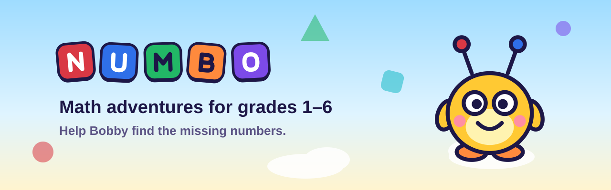
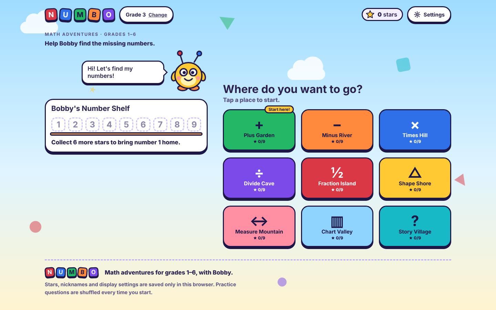
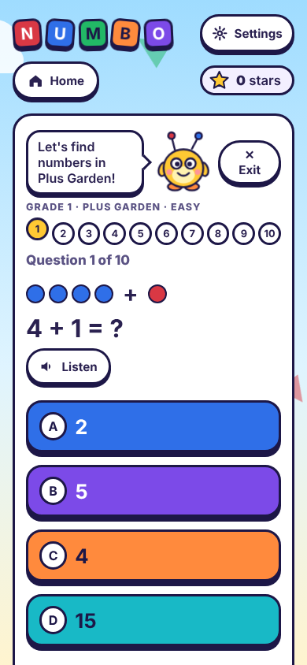

<p align="center">
  
</p>

# Numbo

**Math adventures for grades 1–6, with Bobby.**

Numbo is a small web app that turns practice into a trip. Bobby, a friendly little keeper of numbers, loses his
numbers one to nine. A child travels through nine places (Plus Garden, Minus River, Times Hill and more),
learns each idea with hands-on tools, and plays ten-question rounds to bring the numbers home to Bobby's shelf.

It is one static page. No account, no server, no tracking. Open `dist/index.html` and it works.

<p align="center">
  
  
</p>

> Screenshots were captured with fallback fonts. In a browser with internet access, Numbo uses Fredoka and Nunito.
> Run `python3 scripts/screenshots.py` to refresh them.

## What makes it different

- **A real voice, not a robot.** Every sentence is read aloud by a recorded, natural voice (Kokoro, generated offline),
  including the child's name and cheers like "You're so smart!". Questions are read as whole recorded sentences,
  or built from recorded words when they are too rare to record. The browser's own text-to-speech is never used.
- **Learn by touching.** Place-value blocks, an area model, tap-to-shade fractions, sliders for shapes and measures,
  clocks, rulers and picture graphs. Each lesson has a tool before the quiz.
- **Made for small readers.** Grades 1–2 read questions aloud automatically. Big tap targets (44 px and up), big text mode,
  night mode, soft sound effects on every button, and gentle wording when an answer is wrong.
- **Works on any screen.** Two big tiles per row on phones, a two-column home on laptops, no sideways scrolling from 320 px to 1920 px.
- **Private by design.** Stars, the child's nickname and settings stay in the browser's `localStorage`. Nothing is sent anywhere.

## The nine places

| Place | Topic | Grades |
| --- | --- | --- |
| Plus Garden | Addition | 1–6 |
| Minus River | Subtraction | 1–6 |
| Times Hill | Multiplication | 2–6 |
| Divide Cave | Division | 2–6 |
| Fraction Island | Halves and quarters, equivalent fractions, unlike denominators, percent | 2–6 |
| Shape Shore | Sides and corners, perimeter, area, angles, circles, cubes | 1–6 |
| Measure Mountain | Length and units, clocks and time, speed, map scale, ratio | 1–6 |
| Chart Valley | Picture graphs, bar charts, mode, range, mean, median | 1–6 |
| Story Village | Word problems | 1–6 |

Grade 1 starts with numbers to 20 and six places; Grade 6 reaches fractions, decimals and percent.
Every place has three levels (Easy, Medium, Hard) and earns up to three stars per level.

## Quick start

You only need [Git](https://git-scm.com/) and [Node.js](https://nodejs.org/) 18 or newer. There are no packages to install,
no API key and no account.

```bash
git clone https://github.com/galangekapraja/numbo.git
cd numbo
npm run build        # writes dist/index.html (one self-contained file, about 11 MB with the voice)
npm run serve        # http://localhost:8080  (or just double-click dist/index.html)
npm test             # question generators, voice coverage, app smoke test
```

Faster UI work without the audio: `npm run build:lite` (about 0.2 MB, silent).

Deploying is the same file anywhere static files can live. The included workflow
(`.github/workflows/pages.yml`) publishes `dist/` to GitHub Pages on every push to `main`.
Step-by-step upload and Pages setup: [docs/PUBLISHING.md](docs/PUBLISHING.md).

## How it is built

```
numbo/
├─ src/
│  ├─ index.template.html   page shell (head, fonts, meta)
│  ├─ body.html             markup: background, header, settings, screens
│  ├─ styles.css            design tokens, layout, light and night themes
│  ├─ generators.js         question generators, pure logic with no DOM
│  ├─ speech-text.js        turns questions into speakable words (numbers, units, money)
│  └─ app.js                screens, quiz flow, tools, story, audio engine
├─ assets/audio/
│  ├─ clips/*.mp3           1,041 whole-sentence recordings
│  ├─ clips.json            clip id to sentence
│  ├─ words.mp3             every spoken word on one sprite track
│  └─ words.json            word to [start, duration]
├─ scripts/
│  ├─ build.js              assembles src and audio into dist/index.html
│  ├─ serve.js              tiny static server
│  ├─ screenshots.py        refreshes docs/screenshots
│  └─ voice/                offline voice pipeline (see docs/VOICE.md)
├─ tests/
│  ├─ generators.test.js    64,800 questions: right answers, 4 unique choices, no NaN
│  ├─ voice-coverage.test.js every question word and every simple sum can be spoken
│  ├─ smoke.test.js         whole app in Node with a fake DOM
│  └─ e2e/                  Chromium checks: audio, responsive layout, accessibility
└─ docs/                    brand files, screenshots, design and voice notes
```

The page is assembled in one script scope: `generators.js`, then `speech-text.js`, then `app.js`.
`generators.js` and `speech-text.js` also export themselves for Node, which is how the tests use them.

### The voice in two sentences

Whole sentences (story, lessons, cheers, names, and every Grade 1–2 sum with numbers up to 20) are recorded clips
looked up by a hash of their text. Anything else is spoken by playing recorded words one after another from a single sprite
through the Web Audio API, with a plain `<audio>` fallback if the browser cannot decode it. See [docs/VOICE.md](docs/VOICE.md).

### Adding or changing questions

1. Edit the generator in `src/generators.js` (`GEN.<topic>(level, grade)` returns `{text, choices, answer, explain}`).
2. Run `npm test`. `voice-coverage` tells you if a new word needs a recording.
3. If it does, add the word to `scripts/voice/words.json` and regenerate the sprite (docs/VOICE.md).

## Browser support

Built with plain HTML, CSS and JavaScript, no framework. End-to-end checks run in Chromium (desktop sizes and phone sizes).
Firefox and Safari are expected to work but are not covered by the automated checks yet; audio in particular should be
confirmed by ear on each browser. If you hear nothing, open **Settings > Hear it**: it prints what the audio engine is doing.
Browsers keep audio asleep until the first tap, which is normal.

## Accessibility

Text meets WCAG AA contrast in light and night mode, every control has an accessible name, focus moves to the
new screen heading or question, results are announced politely, motion stops when the system asks for reduced
motion, and the whole app works with a keyboard. `python3 tests/e2e/a11y.py` runs the audit.
Screen-reader testing (VoiceOver, NVDA) is still a manual to-do.

## Contributing

Issues and pull requests are welcome. Please run `npm run build && npm test` first, and keep the tone friendly
for 6 to 12 year olds. Brand notes are in [docs/DESIGN.md](docs/DESIGN.md).

## Author

Created by [@galangekapraja](https://github.com/galangekapraja).

## License

Code and recordings: [MIT](LICENSE). Third-party tools and fonts: [THIRD_PARTY_NOTICES.md](THIRD_PARTY_NOTICES.md).

---

## Ringkasan singkat (Bahasa Indonesia)

Numbo adalah situs latihan matematika SD kelas 1–6 dengan maskot Bobby. Anak menjelajahi sembilan tempat,
belajar dengan alat peraga, lalu mengerjakan 10 soal untuk membawa angka-angka pulang ke rak Bobby.
Semua suara adalah rekaman suara alami yang dibuat offline (bukan suara browser). Tanpa akun dan tanpa server:
bintang dan nama panggilan hanya tersimpan di browser. Jalankan `npm run build`, lalu buka `dist/index.html`.
